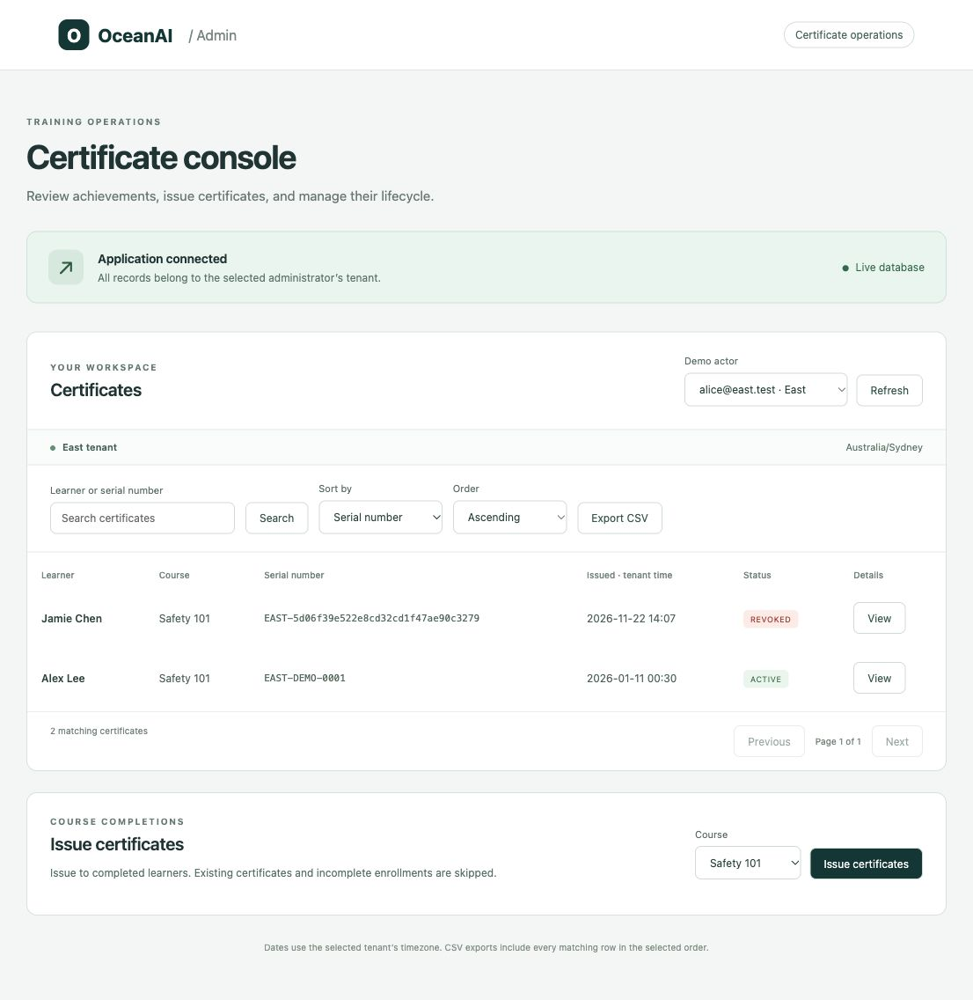

# OceanAI Certificate Console

A multi-tenant certificate admin console built with **Go/Gin, React/TypeScript, and PostgreSQL 18**, started with Docker Compose.

The six planned APIs and their UI workflows are implemented. The A1–A7 acceptance suite passes against isolated PostgreSQL data. **Submission evidence limitations:** Git was initialized during submission packaging, after implementation; earlier incremental commit history is unavailable. The public GitHub remote is [https://github.com/xyang39/OceanAI](https://github.com/xyang39/OceanAI). The [AI evidence snapshot](ai/completeness-declaration.md) is now included, with its limitations and initial implementation commit links documented. See [submission gaps](#submission-gaps-and-known-limits).

Reviewed against the supplied **Ocean AI Labs Beijing – Technical Interview Assessment, version 20261102**, and the implementation plan agreed in this chat. Section 6 was excluded from AI authoring; the candidate's completed [written answer](written-answer.md) is included unchanged.

## Start the application

Prerequisite: a running Docker-compatible engine with Docker Compose v2. OrbStack is supported. No host Go, Node, npm, or PostgreSQL installation is needed; the first build requires internet access.

From the project directory, run:

```sh
docker compose up --build --wait
```

Open **http://localhost:8080**. This command installs declared dependencies inside build containers, compiles both applications, starts PostgreSQL, applies pending migrations, seeds the small demo on first startup, and waits for healthy services. Containers run in the background.

Only the frontend is published, on localhost. For another port, use `APP_PORT=8088 docker compose up --build --wait`, then open http://localhost:8088. The API and database are internal services. The password in Compose is a local demo credential.

## Verify the application

After startup, run:

```sh
sh scripts/verify.sh
```

This is the single verification entry point. It:

1. Runs seven HTTP smoke checks through the application's Nginx frontend, checking the compiled React asset, readiness, actor discovery, tenant reads, dates, and rejected access.
2. Starts a uniquely named temporary Compose project with its own PostgreSQL volume.
3. Runs real PostgreSQL integration tests for A1–A7, migration preservation, concurrency, failed audit writes, query validation, and the 100,000-row fixture.
4. Removes only that temporary project's containers, network, and volumes. The running application's database is preserved.

Plain `go test ./...` runs the timezone tests and skips database tests unless `ACCEPTANCE_DATABASE_URL` is supplied. The verification script supplies this automatically. Use the script for the complete automated checks.

### Recorded verification — 2026-11-22, Asia/Shanghai

Environment: Apple Silicon, macOS 13.4.1, OrbStack 1.11.3, Docker Engine 28.2.2, Compose 2.36.2.

| Check | Observed result |
| --- | --- |
| Compose startup and service health | Passed; PostgreSQL, backend, and frontend healthy |
| Backend build/unit tests | Passed |
| React TypeScript check and Vite production build | Passed |
| Public-service smoke checks | 7 passed |
| A1–A7 PostgreSQL acceptance suite | Passed |
| Version-1 upgrade and repeated startup | Passed; existing learner change preserved, no duplicate certificates/audits |
| A6 first export, paced client | 100,000 rows / 6,100,051 bytes in **2.579 s** |
| A6 second export, unrestricted client | Identical CSV in **0.372 s** |
| List request during first export | Completed in **0.633 s**, before the download finished |
| Browser workflow | Issuance, learner search, detail, confirmed revocation, filtered CSV download, actor switch, empty state, and sort controls checked; no console errors recorded |

The acceptance suite starts the real Gin router using Go's HTTP test server against PostgreSQL. Its A6 timings therefore measure **Gin + PostgreSQL**, not the Nginx proxy or browser download path. The first CSV client reads at most 32 KiB per chunk with a 10 ms pause to ensure an overlapping list request; the second download is unpaced. Nginx and browser export were separately verified with the small dataset. These measurements are local results, not a guarantee on other machines.

Original command output is preserved in [the passing run](output/verification/acceptance-run-2.txt). [The first run](output/verification/acceptance-run-1.txt) is also retained: it failed the overlap assertion because the unpaced export finished before the concurrent list response. The test was changed to pace its first consumer; server behavior was not changed to obtain the passing result.



## Demo data and browser walkthrough

| Tenant | Demo admin header value | Timezone | Safety course ID |
| --- | --- | --- | --- |
| East | `alice@east.test` | `Australia/Sydney` | `east-safety` |
| West | `bob@west.test` | `Australia/Perth` | `west-safety` |

Both tenants initially contain **Safety 101** and three enrollments:

- **Alex Lee:** completed and already certified.
- **Jamie Chen:** completed and eligible for issuance.
- **Sam Taylor:** incomplete.

East also has `east-first-aid`, an initially empty course used to check idempotency-key misuse across courses. The two Alex certificates store the same instant, `2026-01-10T13:30:00Z`: East displays **2026-01-11 00:30**, West **2026-01-10 21:30**.

On a fresh dataset:

1. Select Alice and Safety 101, then **Issue certificates**. Expect one issued, two skipped, zero failed, with reasons for each skip.
2. Search for Jamie; open **View** to inspect the new certificate.
3. Click **Revoke certificate**, then **Confirm revocation**. Its status becomes `REVOKED`.
4. Export CSV with the same search/sort. It contains the matching Jamie row, including the tenant-local issue date.
5. Switch to Bob. With the Jamie search still applied, the initial West dataset is empty. Clear search to see West's Alex certificate and Perth issue time.

The existing local database was used for this browser walkthrough: East Jamie is now issued and revoked. Restarting deliberately preserves that state. Repeating issuance with a new key will skip an already-certified Jamie; the isolated acceptance tests always construct fresh fixtures.

## API contract

All six business endpoints require `X-Actor-Email`. Middleware derives tenant scope from the admin record; a client-provided tenant query parameter cannot change it. Unknown/missing actors receive `401`. Missing and cross-tenant resources receive the same `404` response.

| Endpoint | Request | Response / behavior |
| --- | --- | --- |
| `GET /api/courses` | Actor header | `{items: [{id, title}]}` for the current tenant |
| `GET /api/certificates` | Search, sort, direction, page, page size | `{actor, items, total, page, page_size}`; active and revoked certificates included |
| `GET /api/certificates/:id` | Certificate ID | Serial, learner, course, UTC instant, tenant-local timestamp/date, status |
| `POST /api/courses/:id/issue` | `Idempotency-Key`; body `{}` or no body | `200` with operation ID, `completed` status, counts, and per-learner `issued`, `skipped`, or `failed` outcomes |
| `POST /api/certificates/:id/revoke` | Certificate ID; no body needed | `200` with revoked certificate; repeated requests create no extra audit |
| `GET /api/certificates/export` | Same search/sort/direction as list | CSV containing every matching row; pagination parameters are ignored |

Supporting endpoints: `GET /api/actors` exposes the seeded demo selector, `GET /api/health` checks database readiness, and internal `GET /healthz` checks process liveness. The demo actor header is not production authentication.

### List and export query rules

| Parameter | Default | Accepted values |
| --- | --- | --- |
| `search` | Empty | Trimmed, case-insensitive literal substring of learner name or serial; at most 200 characters; no NUL |
| `sort` | `issue_date` | `learner_name`, `serial_number`, `issue_date` |
| `direction` | `desc` | `asc`, `desc` |
| `page` | `1` | Positive integer with overflow validation |
| `page_size` | `25` | Integer from 1 through 100 |

Invalid parameters return `400`. `%`, `_`, and backslashes are escaped as literal search characters. SQL values are parameterized; sort expressions are allowlisted. Every order ends with certificate ID ascending for deterministic ties. Date sorting uses `(issued_at AT TIME ZONE tenant_timezone)::date`. Empty/out-of-range pages return `items: []`; count and page queries share a read-only Repeatable Read transaction.

CSV columns are `learner_name,course_title,serial_number,issue_date`. List and export share the same filtering/ordering builder. CSV uses Go's CSV writer for quoting, streams rows incrementally, and has a 60-second query context. Server write and Nginx read timeouts are 90 seconds; proxy buffering is disabled. The backend pool allows 10 database connections.

### Mutation behavior

- Issuance keys are required, trimmed, and limited to 200 bytes. The unique scope is **tenant + admin + key**, not course.
- The fingerprint includes the action, course ID, and canonical JSON body. A matching key replays its saved result. A reused key with a different course/body returns `409` without overwriting the result. An unsupported body on a new key returns `400` and leaves no operation record.
- One transaction commits the operation response, new certificates, and issuance audits. Unique enrollment certificates protect against different keys racing. Recoverable row-constraint failures roll back that learner's savepoint and produce `failed`; fatal errors roll back the entire operation.
- The UI disables duplicate submission and actor/course changes while issuing. It retains the key in session storage after ambiguous failures so Retry can recover the original operation, including after a reload in the same tab.
- Revocation conditionally changes `ACTIVE` to `REVOKED` and writes its audit atomically. Revocation is terminal: existing certificates, including revoked ones, are skipped by later issuance.

## Reproducing A1–A7

Run `sh scripts/verify.sh` to execute every row below against fresh, isolated data. Test names appear verbatim in its output. HTTP examples afterward allow manual checks against the running app.

| Scenario | Reproduction and expected result | Automated evidence |
| --- | --- | --- |
| **A1 — Tenant isolation** | Use Bob to list/search/export and request East details, issuance, or revocation. Only West rows are returned; East object operations return `404`. Certificate, audit, and operation counts remain unchanged. | `A1_tenant_isolation`; public smoke also checks detail rejection in both directions |
| **A2 — Retry safety** | Send 12 concurrent Alice requests for East Safety 101 with one key, then replay sequentially. All parsed responses have the same operation ID/results; one eligible certificate and one issuance audit are added. Race eight different keys against another course to confirm certificate uniqueness still holds. | `A2_A4_same_key_concurrency_and_outcomes`, `A2_different_keys_compete` |
| **A3 — Key misuse** | Reuse the successful key with `east-first-aid`, then with a changed JSON body. Both return `409`; original response, certificate count, and audit count remain unchanged. | `A3_key_misuse_preserves_result` |
| **A4 — Learner outcomes** | On fresh Safety 101 data, Jamie is issued, Alex is skipped as `already_certified`, and Sam as `incomplete`. A test-only audit constraint failure verifies a learner becomes `failed` without leaving an unaudited certificate. | Combined A2/A4 test and `learner_failure_rolls_back_certificate_and_audit` |
| **A5 — DST/local date** | Inspect both Alex certificates at the specified UTC instant. Confirm Sydney/Perth timestamps and CSV dates, then exercise equal local-date sorting with different UTC times. | `A5_dates_and_list_contract`; `TestTenantLocalDates` also covers Sydney winter |
| **A6 — Export growth** | Generate 100,000 East fixture certificates with tied names/dates and 100 West fixture rows. Search `Load Learner`, sort by learner name descending, export twice, and request the list during the first export. Compare all CSV fields against an independent SQL result; require identical repeated CSV and each download under 60 seconds. | `A6_100000_row_exports`; exact counts, content, ordering, isolation, overlap, generator repeatability, and elapsed times checked |
| **A7 — Revocation audit** | Revoke the same active certificate concurrently ten times, then repeat sequentially. All return revoked state; exactly one revocation audit exists. Issuance afterward does not replace the revoked certificate. | `A7_revocation_is_repeat_safe` |

Additional checks cover literal wildcard search, SQL-like input, pagination, invalid parameters, CSV quoting, empty results, migration preservation, and cross-tenant audit foreign keys.

### Manual API examples

```sh
# Tenant-scoped list and a non-revealing cross-tenant detail request.
curl -fsS -H 'X-Actor-Email: alice@east.test' \
  'http://localhost:8080/api/certificates?search=Alex&sort=issue_date&direction=desc&page=1&page_size=25'
curl -i -H 'X-Actor-Email: bob@west.test' \
  http://localhost:8080/api/certificates/east-demo-certificate

# Repeat this exact request to replay the same logical operation.
curl -fsS -X POST -H 'X-Actor-Email: alice@east.test' \
  -H 'Idempotency-Key: manual-safety-1' -H 'Content-Type: application/json' \
  -d '{}' http://localhost:8080/api/courses/east-safety/issue

# Reusing that key for another course must return 409.
curl -i -X POST -H 'X-Actor-Email: alice@east.test' \
  -H 'Idempotency-Key: manual-safety-1' -H 'Content-Type: application/json' \
  -d '{}' http://localhost:8080/api/courses/east-first-aid/issue

# Repeating this revocation is safe; it changes the local demo certificate.
curl -fsS -X POST -H 'X-Actor-Email: alice@east.test' \
  http://localhost:8080/api/certificates/east-demo-certificate/revoke
```

Inspect persisted operations/audits without exposing PostgreSQL on the host:

```sh
docker compose exec -T db psql -U oceanai -d oceanai -c \
  "SELECT tenant_id, action, count(*) FROM audit_events GROUP BY tenant_id, action ORDER BY tenant_id, action;"
docker compose exec -T db psql -U oceanai -d oceanai -c \
  "SELECT id, actor_email, idempotency_key, response_status FROM bulk_operations ORDER BY created_at;"
```

## Generate and export 100,000 rows manually

The isolated verification command already performs this test without changing the running demo. To explicitly add the large fixture to the current application database:

```sh
docker compose exec -T backend /app/server seed-large --tenant east --count 100000
```

The generator creates fixture learners, enrollments, certificates, and issuance audits under an `Export fixture` course. IDs are deterministic; repeating the same command does not duplicate them. It adds data and does not delete existing rows or change the default startup seed. Requesting a smaller count later does not remove previously generated rows.

For a full Nginx-path manual A6 check, start a rate-limited first export so the list request overlaps the download:

```sh
curl -fS --limit-rate 1M -H 'X-Actor-Email: alice@east.test' \
  'http://localhost:8080/api/certificates/export?search=Load%20Learner&sort=learner_name&direction=desc' \
  -o /tmp/oceanai-export-1.csv -w 'first export: %{time_total}s\n' &
export_pid=$!
sleep 1
curl -fsS -H 'X-Actor-Email: alice@east.test' \
  'http://localhost:8080/api/certificates?page_size=1'
wait "$export_pid"
curl -fS -H 'X-Actor-Email: alice@east.test' \
  'http://localhost:8080/api/certificates/export?search=Load%20Learner&sort=learner_name&direction=desc' \
  -o /tmp/oceanai-export-2.csv -w 'second export: %{time_total}s\n'
cmp /tmp/oceanai-export-1.csv /tmp/oceanai-export-2.csv
```

Each file should have 100,000 fixture records plus the header, with both timings below 60 seconds. The automated suite performs the exact row/content checks rather than relying on file size alone.

## Architecture and agreement with the plan

```text
Browser → Nginx (:8080) → Gin API → PostgreSQL
           React files              persistent named volume
```

| Planned area | Implementation reviewed |
| --- | --- |
| Six APIs and React workflows | All present; existing visual structure retained |
| Automatic non-destructive migration v2 | Embedded, versioned SQL under a transaction/advisory lock; upgrades existing volumes |
| Data model | Six business tables plus `audit_events` and `bulk_operations`; `schema_migrations` tracks infrastructure changes |
| Tenant integrity | Admin-derived scope on every business route and composite foreign keys for enrollments, certificates, and audit actors/certificates |
| Retry-safe synchronous issuance | Unique operation claim, request fingerprint, saved response, learner savepoints, atomic certificate/audit commit |
| Shared list/export behavior | One parameter parser and filter/order builder; stable ID tie-breaker; tenant-local date expression |
| UI mutation safety | Pending states, confirmation, retained retry keys, and stale-read cancellation |
| Verification and fixture tooling | Isolated test project, repeatable large-data generator, raw failed/passing logs |
| Scope exclusions | No background queue, cache, production authentication, cloud deployment, notifications, or AI-generated section 6 answers |

## Submission gaps and known limits

**Submission status and remaining evidence limits:**

- Git was initialized during submission packaging after implementation. The initial commit records the existing work honestly; it does not reconstruct earlier incremental history. The public GitHub remote is [https://github.com/xyang39/OceanAI](https://github.com/xyang39/OceanAI).
- The [AI evidence snapshot](ai/completeness-declaration.md) now includes [session exports](ai/sessions/), a [session index](ai/session-index.csv), a [decision log](ai/decision-log.md), and original tool action evidence. It is a redacted extraction of the recorded session, including unsuccessful runs, not an untouched internal rollout. Review the declared truncation/redaction limits and refresh after the session ends; initial implementation commit links are recorded; a candidate declaration about any additional AI use remains outstanding.
- Any repository AI instruction files must be retained in the eventual Git submission. No repository-local `AGENTS.md` was present during review.
- The candidate reported completing section 6 on 2026-11-22. Their [written answer](written-answer.md) is included unchanged; the assistant has not authored or reviewed its answers. The supplied filename is `written-answer.md`.
- The assessment specifies a one-hour sitting. Its official start time was not established in this chat, so time-limit compliance is not verified.

**Functional and validation limits:**

- No failing A1–A7 behavior was identified by the recorded acceptance suite. This is bounded verification, not an exhaustive correctness guarantee.
- The 100,000-row timing result is from Gin/PostgreSQL directly; full-size Nginx/browser performance has not been measured. Manual commands above cover that path.
- Browser verification exercised the successful workflow and empty state. Loading/error/retry paths are implemented, but browser network-failure recovery and enabled multi-page navigation were not independently exercised; API pagination and retry semantics were tested.
- Bulk issuance is synchronous with a 30-second transaction context and keeps per-learner results in memory. The 100,000-row requirement was tested for export, not bulk issuance of a course that large.
- Offset pagination and substring matching are intentionally simple. Very deep pages and datasets beyond the tested scale may need further indexing or cursor pagination.
- One certificate per enrollment is supported; revoked certificates cannot be reissued. Export includes active and revoked rows and has no status filter, as agreed.
- A database pool of 10 supports the tested concurrent export/list case; no admission control guarantees availability under arbitrarily many simultaneous exports.

## Operations and source layout

```sh
docker compose ps
docker compose logs --tail=100 backend
docker compose down
```

`docker compose down` preserves application data. `docker compose down --volumes` deletes this project's database and is only for an intentional reset. Restart with the startup command to recreate the small seed after such a reset.

```text
backend/cmd/server/       Server, healthcheck, and seed-large command
backend/internal/api/     Routes, list/export queries, mutations, acceptance tests
backend/internal/store/   Migrations, fixture generator, upgrade test
frontend/src/             React workflows and styling
frontend/nginx.conf       Same-origin API proxy and streaming configuration
scripts/verify.sh         Full verification entry point
scripts/smoke.mjs         Public-service smoke checks
compose.yaml             Application and smoke-check service
compose.verify.yaml      Isolated PostgreSQL acceptance runner
output/verification/     Original verification command output
```

## Submission revision

Public repository: [https://github.com/xyang39/OceanAI](https://github.com/xyang39/OceanAI). The initial implementation snapshot is [4a5222c](https://github.com/xyang39/OceanAI/commit/4a5222ca1ff731f2eb89bdb8e611946ed57b88e7); a subsequent packaging commit links the evidence to that snapshot. Earlier incremental development history is unavailable. Use `git rev-parse HEAD` for the final checked-out submission SHA and `git log --oneline` for the actual commit history.
